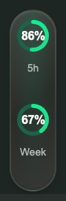

# Codex Usage 2 Rings

在 macOS Codex 桌面端侧栏显示 **5h** 和 **Week** 两个剩余额度圆环。项目只注入这两个用量组件，不添加项目配色、目录大小、会话 Token 或其他栏目。

> 非 OpenAI 官方项目。基于 [jaykinhoo9/codex-usage-badge](https://github.com/jaykinhoo9/codex-usage-badge) 的 MIT 许可源码改编，保留原作者的许可证与署名，详见 [NOTICE](NOTICE.md)。



*示意图使用模拟数值。实际显示以你的 Codex 账号实时额度为准。*

## 功能

- 固定显示 `5h`（300 分钟）和 `Week`（10080 分钟）两个周期的**剩余百分比**。
- 数值位于圆环中心；悬停可查看各周期的重置时间。
- 剩余超过 50% 为绿色，10%～50% 为黄色，低于 10% 为红色。
- 某个周期缺失或数据过期时显示 `—`，不会用另一个周期代替，也不会编造数值。
- 约每分钟刷新一次；深色与浅色主题均可显示。

## 安装

支持 macOS。需要已登录的 Codex 桌面端；登录桌面端与本机 Codex CLI 的账号应一致。API Key 登录不一定提供订阅用量。

### 从 Release 安装

1. 在 [Releases](https://github.com/mingyue220/codex-usage-2rings/releases) 下载最新的 macOS ZIP，并完整解压。
2. 双击 `安装.command`。如果系统阻止双击，可在解压目录运行 `bash ./安装.command`。
3. **完全退出 Codex**，再从原应用图标打开，等待约 5–10 秒。

安装包包含编译好的 macOS 启动助手，不需要 Xcode。需要 Node.js 24+；安装脚本优先查找客户端内置的 Node.js。

### 从源码安装

需要 Python 3、Node.js 24+ 与 Xcode Command Line Tools：

```bash
python3 build.py
python3 scripts/build_native.py
node manage.cjs install
```

## 诊断与卸载

Release 中可运行 `诊断.command`、`卸载.command`。源码目录中运行：

```bash
node manage.cjs status
node manage.cjs uninstall
```

当前已打开的工作窗口不会被安装程序关闭。安装后需要下次从原图标重新打开 Codex，圆环才会出现。安装位置为 `~/Library/Application Support/CodexUsageBadge`，不会改写 Codex 应用包。**本精简版与原版使用同一安装位置和本机端口，二者不能同时运行。**

本精简版关闭了原项目的自动更新；Codex 桌面端升级后若界面结构或 CLI 接口发生变化，可能需要更新本项目。

## 数据与隐私

额度由本机 Codex CLI 的 `account/rateLimits/read` 提供，显示值为 `100 - usedPercent`。程序只通过 `127.0.0.1` 的调试端口连接本机桌面窗口；不读取聊天正文、项目文件、会话数据库或凭据文件，不设置遥测服务。详见 [SECURITY](SECURITY.md)。

## 开发与验证

```bash
npm ci
python3 build.py
npm test
```

浏览器测试覆盖真实 DOM 布局、两个窗口的映射、缺失与过期状态。测试示意图使用模拟数据，不接入测试者的账号。

## 许可

[MIT](LICENSE)。原项目作者的版权声明保留在许可证内；改编来源见 [NOTICE](NOTICE.md)。
